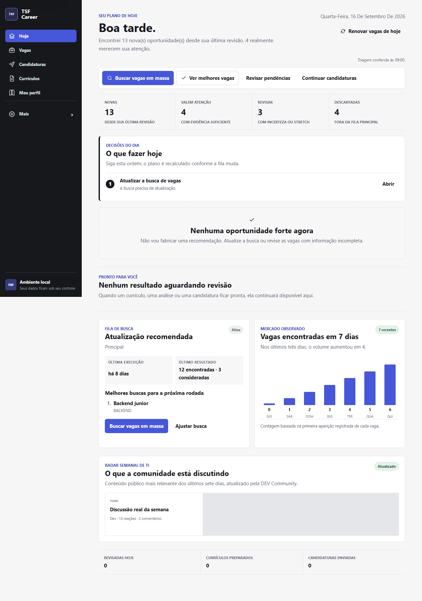

# TSF Career Unified Community

> Um sistema local-first para descobrir vagas, entender compatibilidade, preparar currículos com evidências e conduzir candidaturas com controle humano.

O TSF Career Unified organiza a jornada de busca de emprego em um único produto: descoberta multicanal, deduplicação, ranking explicável, fila diária, preparação de currículo, revisão pelo WhatsApp e candidatura assistida ou controlada. Esta edição pública nasce sem currículos, perfis, bancos de dados, tokens ou histórico pessoal.

O padrão geográfico da edição Community é **Portugal**: Lisboa, Porto, Braga e remoto em Portugal. As superfícies de Brasília/DF e remoto no Brasil continuam disponíveis como opções.

## O que já existe

- Descoberta por agregadores, job boards e páginas públicas de ATS.
- Planejamento de busca por família profissional, senioridade, localização e modalidade.
- Deduplicação, atualização de vagas, qualidade da fonte e histórico de Mass Hunt.
- Ranking com evidências, confiança, elegibilidade e motivos de exclusão.
- Fila **Hoje** para decisões e acompanhamento operacional.
- Importação de currículo e geração de versões direcionadas à vaga.
- Integração opcional com modelos locais via Ollama ou API compatível com OpenAI.
- Fluxos de revisão e confirmação via WhatsApp usando n8n e Evolution API.
- AutoApply e Controlled Submit com gates, idempotência e recibos nos destinos suportados.
- Fallback humano para login, MFA, CAPTCHA, perguntas desconhecidas e confirmação incerta.

> AutoApply e AutoSubmit ficam desativados por padrão. Uma candidatura só deve ser tratada como confirmada quando houver evidência ou recibo positivo.

## Início rápido

### Requisitos

- Docker Desktop com Docker Compose
- Git
- Opcional: Ollama ou LM Studio para redação assistida

~~~powershell
git clone https://github.com/GuilhermeGms3/tsf-career-unified-community.git
cd tsf-career-unified-community
Copy-Item .env.example .env
docker compose up -d --build
~~~

Abra [http://127.0.0.1:7123](http://127.0.0.1:7123).

Antes de ativar WhatsApp, automações ou submissão controlada, preencha somente no arquivo **.env** local os segredos necessários. Nunca envie esse arquivo ao Git.

## Configuração geográfica

O valor padrão pode ser alterado sem modificar código:

~~~dotenv
CAREER_DEFAULT_COUNTRY=Portugal
TZ=Europe/Lisbon
~~~

Na primeira execução, o onboarding oferece Lisboa, Porto, Braga, remoto em Portugal, Brasília/DF e remoto no Brasil.

O Search Composer aceita outras cidades, países e políticas personalizadas. Provedores nacionais continuam respeitando seu próprio alcance; escolher Portugal não transforma uma fonte exclusivamente brasileira em uma fonte portuguesa.

## Arquitetura

~~~text
Browser (HTML/CSS/JS)
        |
        v
Node.js API + domínio + SQLite
        |
        +--> Discovery providers / ATS / JobSpy engine
        +--> Ranking, evidências e fila Hoje
        +--> Resume engine + LaTeX/PDF
        +--> Application engine + receipts
        +--> n8n / WhatsApp (opcional)
        +--> Ollama ou LM Studio (opcional)
~~~

| Caminho | Responsabilidade |
| --- | --- |
| **server.mjs** e **server/** | API HTTP e composição da aplicação |
| **src/discovery/** | Fontes, geografia, normalização e qualidade |
| **src/application/** | AutoApply, Controlled Submit, gates e recibos |
| **src/resume/** | Currículo, templates, renderização e validação |
| **public/** | Interface web modular |
| **engine/** | Serviço Python/FastAPI para JobSpy e extração |
| **automation/** | Workflows n8n e integrações operacionais |
| **tests/** | Testes unitários, integração e fixtures de ATS |

## Desenvolvimento

~~~powershell
npm ci
npm run check:syntax
npm test
~~~

Para validar o serviço Python:

~~~powershell
python -m pip install -r engine/requirements.txt
python -m unittest discover -s engine -p "test_*.py"
~~~

Para conferir a configuração Docker:

~~~powershell
docker compose config --quiet
~~~

## Privacidade e segurança

- Dados operacionais ficam em **data/**, ignorado pelo Git.
- **.env**, tokens, sessões, PDFs, DOCX e artefatos gerados não são versionados.
- URLs externas são tratadas como entrada não confiável.
- CAPTCHA, MFA e autenticação exigem handoff humano.
- Resultados ambíguos não viram candidatura confirmada.
- LLMs não recebem segredos e não têm autoridade para ignorar gates de envio.

Leia [SECURITY.md](SECURITY.md) antes de publicar uma instância na internet.

## Estado e limitações

O projeto é experimental e integra páginas públicas que podem mudar sem aviso. Cobertura de descoberta não implica cobertura de candidatura; o destino final da vaga pode ser um ATS diferente da fonte em que ela foi encontrada. Valide cada provider no seu ambiente e mantenha submissão automática sob limites conservadores.

## Roadmap

- Homologar mais destinos de AutoApply e Controlled Submit.
- Melhorar cobertura para Portugal e outros países europeus.
- Aplicativo móvel e experiência desktop empacotada.
- Catálogo comunitário de company boards verificados.
- Observabilidade e relatórios de qualidade por fonte.

## Contribuindo

Veja [CONTRIBUTING.md](CONTRIBUTING.md). Issues e pull requests são bem-vindos, especialmente para fixtures sanitizadas, correções de providers e testes de geografia.

## English

TSF Career Unified Community is a local-first career operating system for job discovery, explainable ranking, evidence-based resume tailoring and controlled applications. Portugal is the default geography, while Brazil remains available. Personal data, credentials and runtime databases are intentionally excluded.

## Licença

Distribuído sob a licença [MIT](LICENSE).
