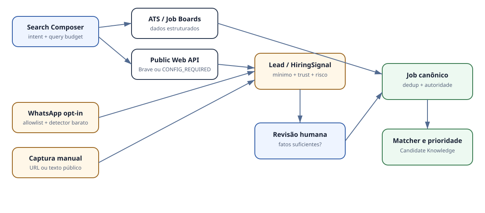
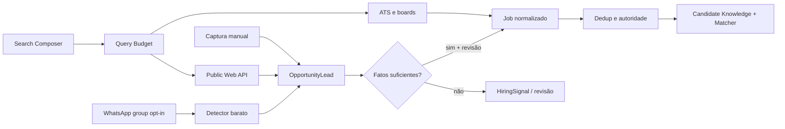

# Discovery V4

O Mass Discovery V4 amplia o Discovery V3 sem criar um motor paralelo.

O resumo de uma execução separa classes solicitadas, operacionais, consultadas, com erro, que exigem configuração e não suportadas. Contagens de funil separam raw, structured, web, community, leads, signals, duplicates, canonical, relevant e priority.

Não há candidatura, outreach, e-mail, mensagem ou submissão automática.

## Correção V4.1

A V4.1 substitui o roteamento genérico por classe e faz Mass Hunt reutilizar o pipeline integral do Job Hunt. Consulte [discovery-v4-1.md](discovery-v4-1.md) e [provider-routing.md](provider-routing.md).
