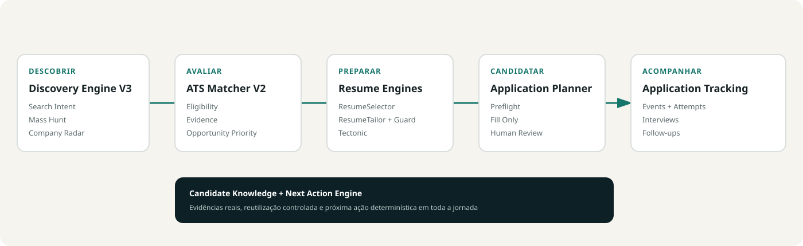

# Career Unified — visão de produto

## Experience V2

Career Unified funciona como um workspace de decisão ao longo de cinco fases: descobrir oportunidades, avaliar evidências, preparar currículo, preparar candidatura e acompanhar resultados. A navegação deixa de refletir engines internos e passa a refletir o trabalho do candidato.

O produto não promete score nativo de ATS, envio automático ou automação que ultrapasse consentimento, CAPTCHA ou MFA. Technical Match, confiança, elegibilidade, prioridade e compatibilidade documental têm nomes e proveniências distintas.

O Career Unified é um operador local e assistido de busca de trabalho. Ele reduz trabalho repetitivo sem retirar decisões do candidato.

## Fluxo principal

1. **DISCOVER** — Fontes e Autopilot encontram vagas, preservam procedência e eliminam duplicatas.
2. **DECIDE** — Hoje prioriza oportunidades e pendências; feedback explícito registra preferências sem alterar o match técnico.
3. **PREPARE** — análises ATS, currículo e conteúdo são preparados com evidências e revisão obrigatória.
4. **APPLY** — o Application Engine pode inspecionar ou preencher, mas nunca submete.
5. **FOLLOW** — candidaturas, alertas e follow-ups permanecem rastreáveis.

## Princípios

- local-first e sem segredos no frontend;
- automação supervisionada, reversível e explicável;
- dados factuais não são substituídos por conteúdo gerado;
- estados `REVIEW_REQUIRED`, `WAITING_USER` e `READY_TO_SUBMIT` são limites de controle humano;
- falha de integração não apaga descoberta nem muda a candidatura.

## Três sinais diferentes

- **Technical Match** compara requisitos da vaga com evidências do candidato. Feedback não altera esse resultado.
- **Opportunity Priority** combina match, confiança, atualidade, preferências explícitas, qualidade do anúncio, esforço e penalidades. A versão atual é `opportunity-priority-v2`.
- **Inbox Attention Priority** ordena apenas as decisões da tela Hoje. É um detalhe interno e não aparece como uma segunda prioridade da vaga.

## Fora de escopo

Não há auto-submit, bypass de CAPTCHA/MFA, stealth, credenciais de candidato no Hub, novo adapter de Gupy/Workday, scraping sem base oficial nem expansão para um Career OS genérico.

## Discovery V4

Descoberta passa a aceitar classes estruturadas, Public Web e sinais comunitários/manuais sem confundir sinal com vaga. O Search Composer mostra disponibilidade real antes da execução. Trust e risco são separados do match; grupos WhatsApp são opt-in e minimizados. LinkedIn permanece manual/link-out. A jornada seguinte continua a mesma e toda promoção ou contato permanece humano.
# Discovery Relevance R2

O produto diferencia oportunidade encontrada, plausibilidade pré-match, Technical Match e Opportunity Priority. A lista pode mostrar “Ignorada nesta busca” com razão humana sem apagar a vaga nem apresentar um falso score de match.
# Source Connection Center V2

Autopilot → Fontes oferece onboarding orientado a tarefas, credencial Brave protegida e gerenciamento de targets por empresa. Portais brasileiros sem adapter continuam rotulados como partner/manual/unsupported, sem falsa promessa.

# Candidate Knowledge V3

O Inventário Profissional transforma palavras isoladas em evidências contextuais revisadas: onde a skill foi usada, com qual profundidade, fazendo o quê e em qual período. Enrichment e Evidence Gaps são fluxos completos de UI; Matcher, currículo e candidatura consomem a mesma autoridade sem autoaprovar fatos.

# Application Engine V2

O workspace de candidatura inclui Preflight fresh e Revisão final com gates server-side, preview mascarada, consentimento específico, histórico, handoff e reconciliação de estado incerto. Greenhouse, Lever, Ashby, SmartRecruiters e Workable possuem Controlled Submit sujeito aos gates; Gupy usa seu pipeline dedicado e Workday permanece assistido por etapa. O transporte externo está desligado por padrão.
